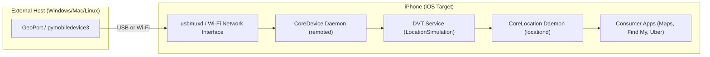
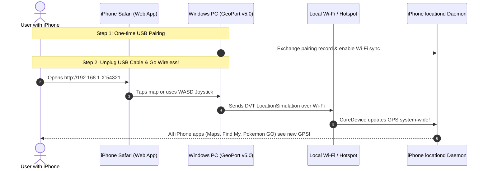

# Running GeoPort: Standalone iPhone vs. Wireless Windows Host

This document explores the technical feasibility and implementation of running GeoPort **independently on an iPhone** versus running it **wirelessly via a Windows host**.

---

## 1. Can GeoPort Run 100% Standalone on an iPhone?

### The Short Answer
* **On Stock (Unjailbroken) iOS:** **No.** Apple's security architecture strictly prohibits apps running on the iPhone from simulating global GPS coordinates for other apps.
* **On Jailbroken iOS or TrollStore (iOS 14.0 – 17.0):** **Yes.** Root privileges and unsandboxed entitlements allow direct manipulation of Apple's location daemon (`locationd`).

---

### The Deep Technical Explanation: Why Stock iOS Blocks On-Device Spoofing

#### 1. Apple's DVT Architecture (Host-Client Model)
GeoPort works by interfacing with Apple's **Developer Tools (DVT)** subsystem:
* **iOS < 17:** Mounts a Developer Disk Image (DDI) and connects to `com.apple.dt.simulatelocation` via Lockdown.
* **iOS 17 & 18:** Connects through Apple's **CoreDevice** RemoteXPC daemon (`remoted`) and Remote Service Discovery (RSD) over QUIC/TCP.

Apple explicitly designed this subsystem as a **host-client architecture**. The "host" (Xcode or a PC running `pymobiledevice3`) acts as the supervisor, and the "client" (the iPhone) acts as the target.



#### 2. Sandbox (Seatbelt) Isolation
Every third-party app installed on an iPhone runs inside a sandboxed container:
* Apps cannot open Unix sockets to `/var/run/usbmuxd` or `/var/run/mDNSResponder`.
* Apps cannot connect to localhost loopback ports associated with system services.
* Apps cannot inject code or modify other processes' memory.

#### 3. Missing Entitlements
To inject mock GPS coordinates into `locationd`, a process must be signed with private Apple entitlements:
* `com.apple.private.dtx.location-simulation`
* `com.apple.locationd.simulation`
* `com.apple.private.mobileinstall.developer`

Apple will never sign App Store or standard developer apps with these entitlements. If an on-device app (e.g. built in Swift or Python via Pyto/iSH) attempts to call `CLLocationManager`, iOS only allows it to *read* the device's real hardware GPS fix.

---

### How to Run Standalone (If You Have a Jailbroken or TrollStore Device)

| Platform | Feasibility | How It Works | Popular Solutions |
| :--- | :--- | :--- | :--- |
| **Jailbroken (Dopamine, Palera1n)** | ✅ **100% Standalone** | MobileSubstrate / ElleKit hooks into `locationd` and `CLLocationManager` directly at the OS level. | *Relocate Reborn*, *LocSim*, *GPSCheat* |
| **TrollStore (iOS 14.0 – 17.0)** | ✅ **100% Standalone** | Exploits the CoreTrust bug to grant arbitrary root entitlements without a full jailbreak. | *LocSim-iOS* (TrollStore IPA) |
| **Stock iOS (iOS 17.4, 18+)** | ❌ **Blocked by Apple** | CoreTrust bug patched; sandbox is impenetrable from within the device itself. | **Wireless Host Setup (Recommended below)** |

---

## 2. The Ideal Solution: Wireless Operation via Windows Host

While stock iOS cannot spoof its own location without a host, **you do NOT need a cable connected to your PC once paired!** 

You can run GeoPort on your Windows PC and control your iPhone's location **entirely wirelessly from your phone screen**.



---

## 3. Step-by-Step Wireless Setup Guide

### Step 1: One-Time USB Pairing
1. Connect your iPhone to your Windows PC with a lightning/USB-C cable.
2. Tap **"Trust This Computer"** on your iPhone screen and enter your passcode.
3. In iTunes (or Apple Devices app), check **"Show this iPhone when on Wi-Fi"**.

### Step 2: Start GeoPort in Wireless Mode
On your Windows machine, run GeoPort with the `--wireless` flag:
```bash
.venv\Scripts\python.exe -m src.main --wireless
```
GeoPort will bind to all network interfaces and output your local network address:
```text
================================================================
  GeoPort v5.0.0 (Windows)
  Desktop URL: http://localhost:54321
  Wireless iPhone Safari URL: http://192.168.1.50:54321
  -> Open this URL on your iPhone Safari to control GPS wirelessly!
================================================================
```

### Step 3: Unplug and Control from Your iPhone
1. **Unplug the USB cable.** Your iPhone and PC now communicate over Wi-Fi.
2. Open **Safari on your iPhone** and navigate to your PC's IP (e.g. `http://192.168.1.50:54321`).
3. *(Optional)* Tap the Safari **Share** icon and select **"Add to Home Screen"**.
4. You now have a standalone-like app icon on your iPhone home screen!
5. Tap anywhere on the map, search a location, or use the on-screen joystick to teleport your phone from anywhere in your house or office.

---

## 4. "On-The-Go" Mobile Hotspot Mode (No External Wi-Fi)

If you are away from home or office Wi-Fi, you can still use wireless location simulation:

1. Turn on **Personal Hotspot** on your iPhone.
2. Connect your Windows laptop to your iPhone's Wi-Fi Hotspot.
3. Both devices are now on the same high-speed private network.
4. Run GeoPort on the laptop and open Safari on your phone.
5. You can now walk around outdoors with full wireless control!
